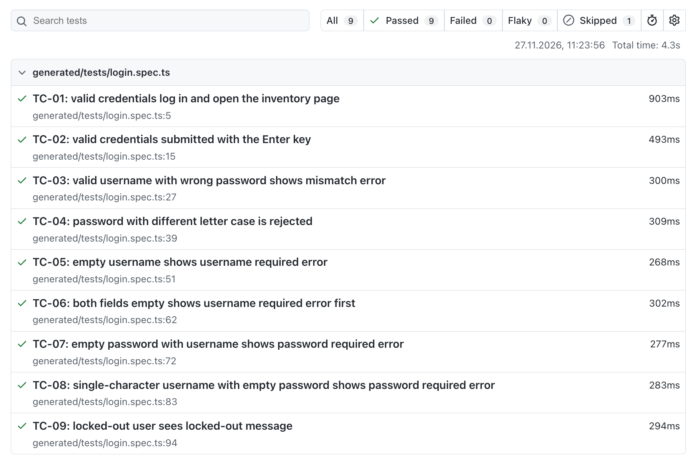

# qa-agent

A personal learning project: an AI-assisted QA pipeline that goes from a ticket to automated Playwright tests, with a check at every stage.

ticket → test cases → human selection → browser agent → Playwright tests → test run

Built with Python, the Claude API (tool use), Playwright MCP and Playwright Test (TypeScript). Not a production tool.

## The pipeline

| Stage | What happens | Files |
|---|---|---|
| 1. Ticket | A Jira-style ticket for the login page of the public demo site saucedemo.com. The five acceptance criteria come from my manual check of the site. | `ticket.txt` |
| 2. Test cases | The agent reads the ticket through a `read_ticket` tool and writes test cases as a markdown table. | `agent.py`, `output_testcases.md` |
| 3. Check | A script validates the table: columns, allowed values, at least 2 cases per acceptance criterion, at least 3 extra cases beyond the ticket. | `check_testcases.py` |
| 4. Selection | A human decides what to automate. Here: the first 10 cases that come from the ticket (the 3 "extra" cases were left out). | `select_cases.py`, `selected_cases.md` |
| 5. Browser agent | For each selected case the agent runs the steps in a fresh browser through Playwright MCP and reports what it actually saw. Then it writes Playwright tests (Page Object Model) whose titles start with the case ID. | `agent_web.py`, `observations/`, `output_web_agent.md` |
| 6. Test run | The generated code is split into files and run with Playwright Test. No AI is needed at this stage. | `extract_tests.py`, `generated/`, `test_results.txt` |

## Results on the saucedemo login ticket (SD-1)

- The agent wrote 13 test cases. The checker passed them: every criterion covered at least twice, 3 extra cases.
- I selected 10 cases to automate.
- The browser agent reported that 9 of the 10 matched the expected result. TC-10 (locked-out user has no session) was not finished: the agent reached the 12-step limit.
- First test run: **7 passed, 2 failed, 1 skipped**. The two failures (TC-01, TC-02) came from an invented locator: the agent's own report said "match", but the generated code looked for a heading named "Products", while the page snapshot shows plain text. I fixed that one line by hand in `generated/pages/InventoryPage.ts`.
- After the fix: **9 passed, 1 skipped** (see `test_results.txt`).


What I took from this: the agent's own "match" is not proof. Running the generated tests found a mistake that the agent's report did not show.

## Earlier experiment: format and coverage over repeated runs

Before the browser part, I ran the test-case agent 10 times on a different, made-up ticket (`ticket_email_login.txt`) and scored every run with the checker (`run_eval.py`, results in `runs/`):

- 9 of 10 runs passed. Run 9 had a table row with a missing cell (a real agent error). Run 10 first failed because of a bug in my checker: the model wrote a second table and the repeated header row was counted as a test case. I fixed the checker and re-scored all 10 runs with the same rules.
- With the final prompt the number of cases was fairly stable (16 to 18). Earlier prompt versions gave very different counts (from 11 to 39, not saved), so the wording of the prompt mattered more than random variation between runs.
- When I asked for "at least two cases per criterion", the agent produced only the minimum, and an explicit request for extra cases was needed. Passing a check is not the same as good coverage.

Note: `run_eval.py` runs the agent on the current `ticket.txt`, so a new run uses the saucedemo ticket, not the one behind `runs/`.

## Safety choices for the browser agent

- The Playwright MCP server has 25 tools. The model only gets 7 (navigate, snapshot, click, type, fill form, press key, wait). Tools that run arbitrary code or upload files are not given to it, and the code rejects any other tool call.
- The browser is limited to one site (`--allowed-origins`). The server's own documentation says this is not a security boundary, so the agent has nothing valuable to protect: it only uses the public demo credentials.
- The system prompt tells the model that page text is untrusted data. This reduces the risk of prompt injection but does not remove it.
- The MCP server runs without my API key (only a few safe environment variables are passed to it), and package versions are pinned.

## Limitations

- The checker validates form and declared coverage, not whether a test case is good. Expected results still need a human review.
- One public demo site and one ticket: a small experiment, not a benchmark.
- The tests depend on a third-party demo site.
- One locator was fixed by hand and TC-10 is not automated. Regenerating the tests overwrites `generated/`, including that fix.
- No CI yet.

## Run it

```
pip install anthropic mcp
npm install
npx playwright install --with-deps chromium
export ANTHROPIC_API_KEY=...       # never commit the key

python agent.py testcases          # write test cases from ticket.txt
python check_testcases.py          # check them
python select_cases.py             # select the first 10 non-extra cases
python agent_web.py                # browser agent (or: python agent_web.py TC-01)
python extract_tests.py            # split the generated code into generated/
npx playwright test                # run the tests
```

Delete `generated/` before regenerating the tests. `python agent.py summary` runs a simpler task (a short summary of the ticket).

## Next steps

- Retry TC-10 with a higher step limit.
- Teach the test-writing step to use text locators when the snapshot shows plain text.
- A golden set of tickets with reference test cases, to measure accuracy and not only format.
- Run the checks in CI.